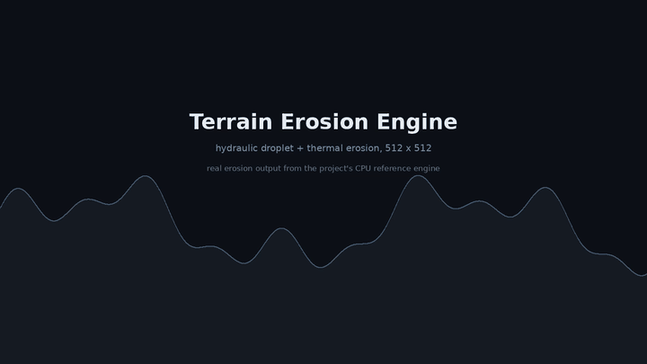
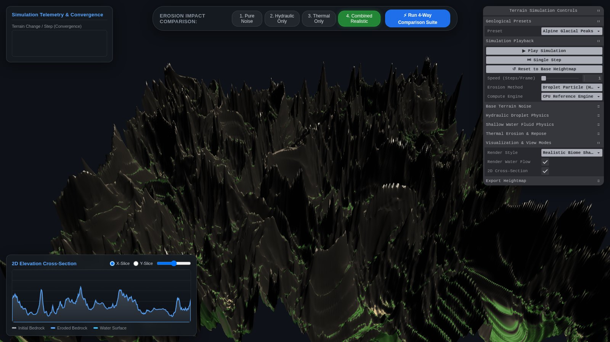

<div align="center">

# Terrain Erosion Engine

**A physically-based procedural terrain generator with hydraulic and thermal erosion, accelerated by WebGPU compute shaders and rendered in real time with Three.js.**

[](https://github.com/rajveersinh-is-dev/terrain-erosion-engine/actions/workflows/ci.yml)
[](LICENSE)
[](https://www.typescriptlang.org/)
[](#compute-backends)
[](#testing)
[](https://rajveersinh-is-dev.github.io/terrain-erosion-engine/)

**[▶ Open the live demo](https://rajveersinh-is-dev.github.io/terrain-erosion-engine/)** — the full generator runs in the browser, no install.



*Alpine Glacial Peaks eroding over 130 steps — [watch the full demo](assets/demo.mp4) (hydraulic droplet + thermal, 512 × 512, rendered from the engine's output).*

</div>

---

## Overview

Terrain Erosion Engine generates a heightfield from configurable fractal noise, then erodes it with three independent, physically motivated models — particle-based hydraulic erosion, grid-based shallow water, and thermal talus relaxation — on either the GPU (WebGPU compute shaders) or a CPU reference implementation. The result is streamed into a Three.js scene with real-time camera controls, live telemetry, a 2D cross-section, and a 4-way A/B comparison of erosion regimes. Heightfields export as 16-bit PNG, Float32 RAW, or a Wavefront OBJ mesh.

Everything is a browser application: TypeScript, Vite, WebGPU/WGSL and Three.js, with no server component.



*The application: 3D viewport, Tweakpane parameter panel, live telemetry, and a 2D elevation cross-section.*

---

## Features

- **Three erosion models** — droplet/particle hydraulic erosion (Hans Beyer's method), grid-based shallow water (pipe model, after Mei et al.), and thermal talus-angle relaxation with separate bedrock and sediment angles.
- **WebGPU compute + CPU reference** — every model runs as a WGSL compute shader for GPU throughput, with an equivalent CPU implementation used as the correctness reference and as a fallback when WebGPU is unavailable.
- **Interleaved multi-model stepping** — run hydraulic and thermal erosion together in a configurable ratio and order, so channel incision and slope relaxation interact.
- **Procedural terrain** — simplex, ridge and billow noise with domain warping, configurable octaves, persistence, lacunarity and power redistribution.
- **Real-time visualisation** — shaded or biome-coloured terrain, flowing water surface, camera orbit/zoom, and a live 2D cross-section with the water line.
- **4-way comparison suite** — one click generates pure noise, hydraulic-only, thermal-only and combined results, then toggles between them to isolate each model's contribution.
- **Exports** — 16-bit grayscale PNG heightmaps, Float32 RAW heightmaps, and Wavefront OBJ meshes.
- **Telemetry** — per-step timing, droplet throughput, terrain change, convergence rate and mass-balance error.

---

## Erosion models

| Model | Type | What it simulates |
|---|---|---|
| **Droplet particle** | Lagrangian | Drops of water with momentum and sediment capacity carve and deposit along their path; the workhorse for dendritic channel networks |
| **Shallow water** | Grid / Eulerian | A pipe-model shallow-water solve with rainfall, evaporation, sediment transport and deposition; produces sheet flow and deltas |
| **Thermal** | Grid / local | Material above the talus angle slumps to neighbours; smooths over-steep slopes and forms scree aprons. Bedrock and loose-sediment angles are configured separately |

## Compute backends

Each erosion model has two implementations behind one interface:

- **WebGPU compute (`*.wgsl`)** — `droplets.wgsl`, `shallow-water.wgsl` and `thermal.wgsl` run thousands of droplets or full-grid passes per frame. Heightfield writes use fixed-point atomics so many droplets can erode and deposit concurrently.
- **CPU reference (`droplet-cpu.ts`, `shallow-water-erosion.ts`, `thermal-erosion.ts`)** — the ground-truth implementation, also used automatically when `navigator.gpu` or a suitable adapter is unavailable.

The engine probes for WebGPU at startup and selects the backend automatically; the panel shows which one is active.

---

## Presets

| Preset | Character | Noise | Dominant process |
|---|---|---|---|
| `alpine-peaks` | Towering crests, knife-edge ridges, glacial cirques | ridge, 6 octaves | hydraulic + thermal |
| `canyonlands` | Steep-walled plateau canyons, alluvial deposits | simplex, 5 octaves | hydraulic incision |
| `river-basin` | Gentle lowlands, dendritic streams, lake basins | simplex, 5 octaves | hydraulic transport |
| `badlands` | Dense rills, ravines and sharp mudstone spurs | billow, 6 octaves | aggressive hydraulic |

---

## Getting started

Requires **Node.js 20+**. WebGPU is used when available; otherwise the CPU reference backend runs instead.

```bash
git clone https://github.com/rajveersinh-is-dev/terrain-erosion-engine.git
cd terrain-erosion-engine
npm ci

npm run dev        # dev server on http://localhost:3000
npm run build      # production bundle in dist/
npm run preview    # serve the production build
npm run typecheck  # tsc --noEmit
npm test           # vitest run
```

WebGPU needs a Chromium-based browser (Chrome/Edge 113+) or Safari 18+; Firefox support is behind a flag.

---

## Using the interface

1. **Pick a geological preset** or tune the terrain noise and open the erosion parameter folders.
2. Press **▶ Play Simulation** to run continuously, or **⏭ Single Step** to advance one step at a time. **Speed (Steps/Frame)** controls how many steps are integrated per rendered frame.
3. Choose the **Erosion Method** (droplet / shallow water / thermal) and the **Compute Engine** (WebGPU / CPU).
4. Use **Run 4-Way Comparison Suite**, then toggle buttons **1–4** to compare noise-only, hydraulic-only, thermal-only and combined results.
5. Export the current heightfield from the **Export Heightmap** folder.

---

## Architecture

```
src/
├── core/            heightmap.ts · noise.ts · prng.ts · presets.ts · types.ts
├── erosion/         erosion-manager.ts        orchestration + telemetry
│                    droplet-cpu.ts / droplet-gpu.ts      particle hydraulic
│                    shallow-water-erosion.ts            grid shallow water
│                    thermal-erosion.ts                  talus relaxation
├── shaders/         droplets.wgsl · shallow-water.wgsl · thermal.wgsl
├── rendering/       viewport.ts · terrain-mesh.ts · water-mesh.ts · terrain-material.ts
├── ui/              parameter-panel.ts · telemetry-overlay.ts
│                    cross-section-view.ts · comparison-view.ts
├── export/          png16-exporter.ts · raw-exporter.ts
└── main.ts          application wiring and the animation loop
```

`ErosionManager` owns the models and exposes a single `step(heightmap, droplet, thermal, shallowWater, interleave)` entry point that applies the interleave policy and returns timing and convergence data.

---

## Testing

```bash
npm test
```

35 tests across 10 files cover the noise/PRNG, heightmap maths and sampling, each erosion model, the erosion manager's interleaving, the comparison stages, and the PNG-16/RAW exporters. CI runs typecheck, tests and a production build on Node 20.x and 22.x.

The suite includes a benchmark that runs 10,000 droplets on a 256 × 256 heightfield (≈ 150 ms on a single CPU core in CI).

---

## License

MIT — see [LICENSE](LICENSE).
